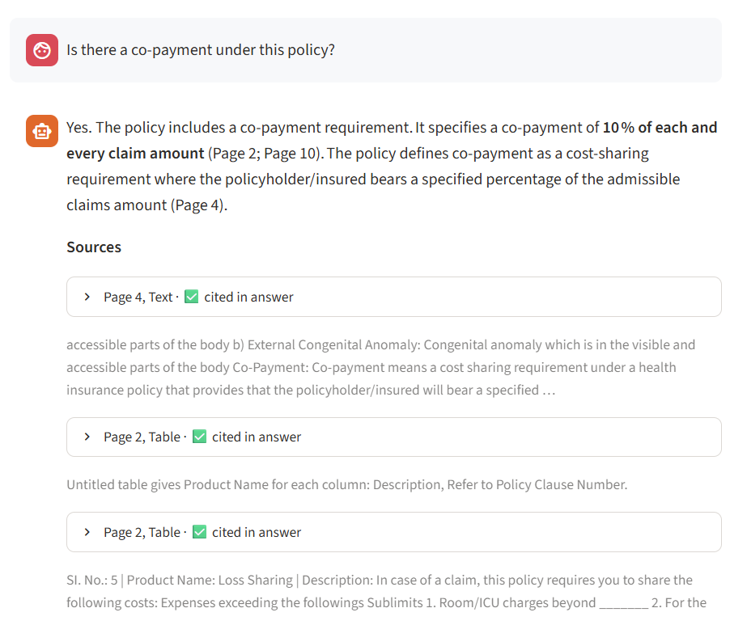
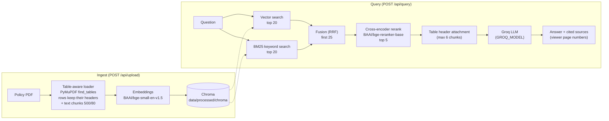

# PolicyPal

Ask plain-English questions about an insurance policy PDF and get answers that
cite the pages they came from.



---

## What PolicyPal is

PolicyPal is a retrieval-augmented generation (RAG) app over a single
insurance policy document. You upload a policy PDF; PolicyPal parses it
(including its tables), indexes it locally, and answers questions using only
the retrieved policy text. Every answer comes with the source chunks it was
given, labelled with the PDF viewer's page numbers, and the pages the answer
cites are marked.

It was built and evaluated on one document: the Star Health Assure Insurance
Policy wording (20 pages).

---

## Architecture



**Ingest.** `app/services/table_loader.py` finds tables with PyMuPDF
(`find_tables`, `lines_strict`) and writes each table row as its own chunk with
its column headers repeated, for example
`[SCHEDULE OF BENEFITS] S.No: 29 | Benefit: Co-payment | Sum Insured (INR) -> 5 lacs / … / 2 Crore: subject to co-payment of 10% …`.
Each table also gets one header chunk ("Table SCHEDULE OF BENEFITS gives
Benefit for each Sum Insured (INR): 5 lacs, 10 lacs, …"). The table title is the
paragraph directly above the table plus any title rows inside it. Text that is
not in a table is split with `RecursiveCharacterTextSplitter` (500 / 80).
Chunks that are identical on several pages are stored once, with all pages in
the `pages` metadata.

**Query.** `retrieve_and_rerank` in `app/services/rag_chain.py` fuses vector
and BM25 candidates, reranks them with a cross-encoder, and, when a table row
is retrieved, adds that table's header chunk so the row's columns make sense.
The LLM sees chunks labelled with 0-indexed page numbers; the API converts the
answer's `(Page N)` citations to the viewer's 1-indexed page numbers.

---

## Tech stack

| Component | Choice |
|---|---|
| LLM (answers) | Groq, model from `GROQ_MODEL` (default `openai/gpt-oss-120b`) |
| Embeddings | `BAAI/bge-small-en-v1.5` (local, CPU) |
| Keyword search | `rank-bm25` over the indexed chunks |
| Reranker | `BAAI/bge-reranker-base` cross-encoder (local, CPU) |
| Vector store | ChromaDB, persisted in `data/processed/chroma` |
| PDF parsing | PyMuPDF (text + `find_tables`) |
| Orchestration | LangChain (LCEL) |
| API / UI | FastAPI, Streamlit |
| Evaluation | RAGAS (Groq judge), plus a local retrieval hit-rate script |

---

## Setup

Developed on Windows with Python 3.13 (3.13.5).

```bash
# 1. Virtual environment
python -m venv venv
venv\Scripts\activate          # macOS/Linux: source venv/bin/activate

# 2. Dependencies
pip install -r requirements.txt

# 3. Environment variables
copy .env.example .env         # macOS/Linux: cp .env.example .env
```

`.env` keys:

| Key | Used by | Notes |
|---|---|---|
| `GROQ_API_KEY` | API, evaluation | Required. Get one at https://console.groq.com |
| `GROQ_MODEL` | API | Answering model; default `openai/gpt-oss-120b` |
| `GROQ_JUDGE_MODEL` | `scripts/run_ragas.py` | RAGAS judge model, kept separate from the answering model |
| `POLICYPAL_API_URL` | Streamlit | Optional; default `http://localhost:8000` |

**First run.** The embedding and reranker models (about 1 GB together) are
downloaded from Hugging Face the first time they are used. The first ingest of
a PDF is also slow because table extraction runs on every page: a full
re-index of the 20-page sample policy (parsing, tables and embeddings) took
about 80 seconds on the CPU-only development machine.

### Run

```bash
# API (no --reload: a reloading server restarts on every file change and
# keeps Chroma's files open, which blocks re-indexing on Windows)
uvicorn app.main:app

# UI, in a second terminal
streamlit run streamlit_app.py
```

The API docs are at `http://localhost:8000/docs`; the UI opens at
`http://localhost:8501`. Upload a PDF in the sidebar ("Index document"), then
ask questions in the chat.

To re-index from the command line instead (stop the API first):

```bash
python scripts/reindex.py data/raw/StarHealthAssureInsurancePolicy-Policy-wording.pdf
```

Uploading or re-indexing replaces the previously indexed document.

### Run with Docker

Requires Docker with Compose v2 and a `.env` file in the repo root (same keys
as above). `.env` is read by Compose at run time and is not copied into the
images.

```bash
docker compose build      # API image (CPU-only PyTorch) and UI image
docker compose up -d      # API on http://localhost:8000, UI on http://localhost:8501
curl http://localhost:8000/health
curl -X POST http://localhost:8000/api/upload \
  -F "file=@data/raw/StarHealthAssureInsurancePolicy-Policy-wording.pdf"
docker compose down       # keeps the volumes; `down -v` deletes the index and model cache
```

- Two named volumes: `chroma` (the index, survives restarts and `down`) and
  `hf-cache` (Hugging Face models, `HF_HOME`). The images contain no data and
  no index; upload a PDF after the first start.
- First start: the API loads both models before it reports healthy, so on an
  empty `hf-cache` volume it first downloads the embedding model and the
  reranker (about 1.2 GB together). The health check allows up to 20 minutes
  for this, and the UI starts only once the API is healthy. Later starts reuse
  the volume. To skip the download at run time, build with the models baked
  into the image: `docker compose build --build-arg PRELOAD_MODELS=true api`.
- Measured on the development machine (Docker Desktop, CPU only, slow
  network): build about 21 minutes; API image 2.5 GB, UI image 894 MB;
  upload of the 20-page policy 36 s (486 chunks); queries 5–11 s once the
  models are cached. (Before the reranker was loaded at startup, the first
  query took 21 minutes because it downloaded the reranker.)
- The API runs uvicorn without `--reload` as a non-root user. Uploaded PDFs
  are written inside the container (`/app/data/raw`) and are not kept when
  the container is recreated; the index is.
- Not verified: `PRELOAD_MODELS=true` builds, running on Linux or macOS
  hosts, GPU use (the images are CPU-only), and the UI in a browser (only its
  health endpoint was checked).

### Deploying a demo

The `demo` target is one container for a public demo: uvicorn on
`127.0.0.1:8000` (not exposed) and Streamlit on `$PORT` (default 7860), which
calls the API on localhost. It runs as a non-root user (uid 1000) and indexes
one fixed policy, the Star Health policy wording copied into the image, on
startup. `demo` is the last stage in the Dockerfile, so a platform that builds
the Dockerfile without naming a target gets it.

```bash
docker build --target demo -t policypal-demo .
docker run -p 7860:7860 -e GROQ_API_KEY=... policypal-demo    # or --env-file .env
# open http://localhost:7860
```

Environment variables (secrets come only from the environment; the image has
no `.env`):

| Variable | Default in `demo` | Notes |
|---|---|---|
| `GROQ_API_KEY` | none | **Required.** Set it as a secret on the host. |
| `GROQ_MODEL` | `openai/gpt-oss-120b` | Answering model. |
| `DEMO_MODE` | `true` (`false` elsewhere) | Uploads return 403 and the UI hides the uploader. |
| `DEFAULT_POLICY_PDF` | `/app/demo/policy.pdf` | Indexed on startup **only if the index is empty**. |
| `RATE_LIMIT_PER_MINUTE` | `10` | Per client IP, rolling window; `0` disables. |
| `RATE_LIMIT_PER_DAY` | `100` | Per client IP, rolling 24 h; `0` disables. |
| `MAX_QUESTION_CHARS` | `500` | Longer questions get a 422. |
| `PORT` | `7860` | Streamlit's port; most hosts set this themselves. |
| `API_PORT` | `8000` | Internal API port. |
| `DEMO_POLICY_NAME` | Star Health policy | Name shown in the UI's demo note. |

Build arg: `PRELOAD_MODELS=true` bakes both models (about 1.2 GB) into the
image, so a host without a persistent disk does not download them on every
cold start.

**Indexing at startup, not at build time.** The index is built by the running
app (the same embedding code path as an upload), which keeps the build free of
model downloads and keeps the image working with or without a mounted index
volume. The cost is about 60 s of indexing on each start with an empty index.

**Memory (measured locally, Docker Desktop, CPU only).**

| | Memory |
|---|---|
| Two-container setup, API container, idle | 919 MiB |
| Two-container setup, API container, during a query | 1.09 GiB (sampled peak) |
| `demo` container, idle after indexing the policy | 1.06–1.17 GiB |
| `demo` container under a hard 2 GB cap, cold start + one query | peak 1407 MiB, no OOM events |

Plan for **2 GB of RAM**. 1 GB is too small, since the idle process alone is
about 1.1 GB. Concurrent queries add to the peak; only one query at a time was
measured.

Other measurements:
- **Image size:** the `demo` image is 3.0 GB.
- **Startup:** 109–130 s to a healthy API with the models already cached,
  including 59–65 s of indexing (486 chunks).
- **Queries:** 9–17 s each.

**Rate limiting** is in memory, per process. It is reset by a restart and not
shared between replicas, so run a single instance. The client IP is the
right-most `X-Forwarded-For` entry: the left-most entries are set by the client
and could be forged to get around the limit. Behind more than one proxy hop the
right-most entry may be a proxy address, so all users would share one bucket;
check this on your host. The limiter does not cap total Groq usage, so also set
a spending limit on the Groq account.

**Platform notes. None of these were tried; all are unverified.**

- **Render (unverified).** Create a Docker web service from the repo. Without
  a target setting, the last stage (`demo`) is built. Add `GROQ_API_KEY` as a
  secret environment variable. Render sets `PORT`, which the start script
  uses. The free instance type has less than 2 GB of RAM, so pick a paid type
  with at least 2 GB. Without a persistent disk, every deploy or restart
  re-indexes the policy (about a minute) and downloads the models unless they
  are baked in with `PRELOAD_MODELS=true`.
- **Railway (unverified).** Railway builds a root `Dockerfile` automatically
  (last stage, `demo`) and sets `PORT`. Add `GROQ_API_KEY` under Variables.
  Volumes could hold the index (`/app/data/processed/chroma`) and the models
  (`/models/huggingface`). Railway volumes may be mounted as root, and this
  image runs as uid 1000, so check write access. Railway documents a
  `RAILWAY_RUN_UID=0` variable for this case, which runs as root. Memory is
  billed by usage, so expect about 1.1–1.4 GB.
- **Hugging Face Spaces (unverified).** Create a Docker Space and push this
  repo to it. The Space's README needs the YAML header `sdk: docker` and
  `app_port: 7860`. Spaces run containers as uid 1000, which this image
  already uses. Add `GROQ_API_KEY` as a Space secret. The free CPU hardware has
  more than 2 GB of RAM. Without paid persistent storage, the policy is
  re-indexed after each restart or wake from sleep. Check whether the
  `X-Forwarded-For` behaviour above gives per-user rate limits there.

---

## API

### `POST /api/upload`

```bash
curl -X POST http://localhost:8000/api/upload \
  -F "file=@data/raw/StarHealthAssureInsurancePolicy-Policy-wording.pdf"
```

```json
{
  "job_id": "a1b2c3d4-...",
  "status": "completed",
  "filename": "StarHealthAssureInsurancePolicy-Policy-wording.pdf",
  "chunks_created": 486
}
```

### `POST /api/query`

```bash
curl -X POST http://localhost:8000/api/query \
  -H "Content-Type: application/json" \
  -d '{"question": "Is there a co-payment under this policy?"}'
```

Response (abridged; `text` holds the full chunk):

```json
{
  "answer": "Yes. The policy includes a co-payment of 10 % of each and every claim amount (Page 10). ...",
  "sources": [
    {
      "page": 10,
      "pages": [10],
      "chunk_type": "text",
      "title": null,
      "snippet": "... 30. Co-payment: This policy is subject to co-payment of 10% of each and every claim amount for fresh as well as renewal policies for insured person whose age at the time of entry is 61 years and above.",
      "text": "..."
    }
  ],
  "cited_pages": [2, 10]
}
```

- `sources`: retrieved chunks in retrieval order. `page` / `pages` are viewer
  page numbers (the first page of the PDF is 1). `chunk_type` is `text` or
  `table`; `title` is the table's title when known.
- `cited_pages`: sorted viewer pages cited in the answer (empty if none).

Errors return `{"detail": "..."}`:
- **422:** the question is longer than `MAX_QUESTION_CHARS` (default 500).
- **429:** the per-IP rate limit was reached; a `Retry-After` header is set
  (see [Deploying a demo](#deploying-a-demo)).
- **400:** the question is empty.
- **404:** no document is indexed.

`POST /api/upload` returns 403 when `DEMO_MODE` is on.

### `GET /health`

Returns `{"status": "ok", "demo_mode": false}`. The UI reads `demo_mode` to
decide whether to show the uploader.

---

## Project structure

```
policypal/
├── app/
│   ├── main.py                 # FastAPI app; lifespan loads embeddings + reranker, builds BM25
│   ├── routers/
│   │   ├── ingestion.py        # POST /api/upload
│   │   └── query.py            # POST /api/query (rewrites citations to viewer pages)
│   ├── schemas/query.py        # request/response models (Source, cited_pages)
│   ├── prompts/qa_prompt.py    # answering prompt
│   ├── services/
│   │   ├── table_loader.py     # table-aware PDF loading and chunking
│   │   ├── document_loader.py  # load_and_chunk (falls back to the plain loader)
│   │   ├── embedder.py         # bge-small embeddings
│   │   ├── vectorstore.py      # Chroma; ingest replaces the collection
│   │   ├── hybrid.py           # BM25 + vector fusion (RRF)
│   │   ├── reranker.py         # bge-reranker-base cross-encoder
│   │   ├── rag_chain.py        # retrieval, header attachment, LCEL chain
│   │   └── citations.py        # structured sources, page-citation rewriting
│   │   └── rate_limit.py       # in-memory per-IP limiter for POST /api/query
│   └── core/
│       ├── logger.py           # structured JSON logging
│       └── settings.py         # DEMO_MODE, rate limits, question length (env)
├── streamlit_app.py            # chat UI with per-chunk sources
├── scripts/
│   ├── reindex.py              # re-index a PDF through the upload path
│   ├── retrieval_hit_rate.py   # local retrieval hit rate (no LLM)
│   ├── run_ragas.py            # RAGAS evaluation (calls Groq)
│   └── inspect_retrieval.py    # print retrieved chunks for a question
├── eval/
│   ├── eval_set.json           # 25 questions with ground truths
│   ├── eval_keyword_set.json   # 6 keyword-style questions (not yet human-verified)
│   ├── hit_rate_*.json         # retrieval hit-rate results
│   └── archive/                # frozen RAGAS baseline (see its README)
├── tests/                      # test_citations.py, test_limits.py
├── docker/                     # slim requirement lists, start-demo.sh
├── notebooks/                  # early exploration
├── data/raw/                   # uploaded PDFs
└── data/processed/chroma/      # vector store (not committed)
```

---

## Tests

```bash
python -m pytest -q tests
```

The tests mock the LLM (no Groq calls). They check the structured sources
(1-indexed pages), the citation rewriting (`(Page 4)` → `(Page 5)`,
`(Pages 4-5)`, `(Page 4, 5)` and similar), and that the prompt the LLM receives
is byte-identical to the original format. One test runs a real retrieval
against the local index and is skipped if no document is indexed.
`tests/test_limits.py` covers the rate limiter (fake clock), the
`X-Forwarded-For` handling, the 422 and 429 responses, and the demo-mode 403
on upload, using a stub chain.

---

## Evaluation

All numbers come from one policy document and small question sets. Treat them
as a sanity check of this project, not a benchmark.

### RAGAS baseline

From `eval/archive/baseline_summary.json` (run `20261117_185415`).

Baseline retrieval setup: the original loader (PyMuPDF text, no table
handling, 500/80 chunks), plain vector search returning the top 3 chunks, no
BM25, no reranking, no table header attachment.

| Metric | Score |
|---|---|
| Faithfulness | 0.953 |
| Context precision (with reference) | 0.587 (scored on 23 of 24 questions; one judge call failed) |
| Context recall | 0.555 |
| Answer relevancy | not measured |

- Generator `openai/gpt-oss-120b`, judge `qwen/qwen3.8-27b` (a single judge
  model), 24 answerable questions from one policy.
- The one unanswerable question ("What is the maximum entry age for the
  policy?") was correctly refused (1 of 1).
- The baseline's answers were not saved, so which version of the prompt
  produced them is not recorded.
- At the time of the baseline, `scripts/run_ragas.py` took the contexts it
  scored from its own plain vector top-3 retriever. For the baseline that
  matched what the model saw. The script now scores the chunks the chain
  actually put in the prompt (`--retriever pipeline`, the default);
  `--retriever vector_k3` keeps the baseline's retrieval for both answers and
  contexts.

**TODO: final RAGAS comparison pending judge.** The after-pipeline RAGAS run
(table-aware parsing + hybrid search + reranking + header attachment) is
incomplete because most judge calls failed, so it is not reported here. Its
saved contexts came from vector top 3 rather than from the pipeline; they have
been recomputed from the pipeline into
`eval/answers_after_pipeline_refreshed.json` (answers unchanged) for
re-scoring with
`python scripts/run_ragas.py --reuse-answers --answers-file eval/answers_after_pipeline_refreshed.json`.

#### Reproduce the baseline

No single commit holds the exact baseline state, so this is an approximation.
Commit `05e06d8` has the original loader and the vector top-3 chain; the eval
set and `run_ragas.py` were committed later, and the baseline's generator
(`openai/gpt-oss-120b`) was set in an uncommitted edit, so `05e06d8` needs a
one-line model change. The worktree keeps its own `data/processed/chroma`, so
the main index is not touched. Running RAGAS calls Groq. Commands are for
Windows, run from the repo root, using the main checkout's venv:

```bat
git worktree add ..\policypal-baseline 05e06d8
mkdir ..\policypal-baseline\scripts ..\policypal-baseline\eval
copy scripts\run_ragas.py ..\policypal-baseline\scripts\
copy eval\eval_set.json ..\policypal-baseline\eval\
copy .env ..\policypal-baseline\
cd ..\policypal-baseline
rem In app\services\rag_chain.py, change model="llama-3.3-70b-versatile"
rem to model="openai/gpt-oss-120b" (the baseline's generator).
..\policypal\venv\Scripts\uvicorn app.main:app
rem In a second terminal (in ..\policypal-baseline):
rem   curl -X POST http://localhost:8000/api/upload -F "file=@data/raw/StarHealthAssureInsurancePolicy-Policy-wording.pdf"
rem Stop uvicorn, then:
..\policypal\venv\Scripts\python scripts\run_ragas.py
```

Differences from the original run: `05e06d8` contains the original prompt,
while the prompt used for the baseline is not recorded (see above);
`eval/eval_set.json` was edited after the baseline run; and the judge's
scores vary between runs.

### Retrieval hit rate (local, no LLM)

`scripts/retrieval_hit_rate.py` counts a question as a hit when any of the
top 5 retrieved chunks comes from the page(s) named in the question's
`source` field. Main set: the 17 questions in `eval/eval_set.json` that have a
source page. Keyword set: the 6 questions in `eval/eval_keyword_set.json`,
each built around a distinctive term (an abbreviation like IONM, a named
procedure, a defined term, an exclusion code).

| Retrieval mode | Main set (17) | Keyword set (6) |
|---|---|---|
| Vector top 5 | 14/17 | 5/6 |
| Vector top 20 → rerank top 5 | 14/17 | 5/6 |
| Hybrid (vector + BM25) top 25 → rerank top 5 | 15/17 | 6/6 |

- The hybrid row is the same at every weighting tried (vector/BM25 = 0.7/0.3,
  0.5/0.5, 0.3/0.7 and BM25-only 0.0/1.0). The weights made no difference.
- The differences between modes are one question on each set, which is
  within what a different question set could change.

Reproduce:

```bash
python scripts/retrieval_hit_rate.py vector_top5
python scripts/retrieval_hit_rate.py vector_rerank
python scripts/retrieval_hit_rate.py hybrid_rerank --w-vector 0.5 --w-bm25 0.5
python scripts/retrieval_hit_rate.py my_label --mode hybrid_rerank --eval-file eval/eval_keyword_set.json
```

---

## Known limitations

- **Q5 "What are the sum insured options available?" fails in every retrieval
  mode.** The chunk that lists all nine options (the Schedule of Benefits
  header, "Table SCHEDULE OF BENEFITS gives Benefit for each Sum Insured
  (INR): 5 lacs, …, 2 Crore.") is 15th in vector search, so it is not in the
  plain top 5. With vector + rerank it reaches the cross-encoder, which scores
  it 0.038 against a top-5 cutoff of about 0.28 (13th of 20). With hybrid +
  rerank it does not survive fusion: BM25 ranks it 325th of 486 (the word
  "options" does not appear in the policy, and "sum insured" appears in a
  large share of all chunks), so it falls outside the 25 candidates passed to
  the reranker.
- **Q6 "What is the ICU charge limit?" fails in every reranked mode.** The
  Schedule of Benefits chunk that holds the row "ICU/Operation Theatre
  Charges: Actual" is 4th in the plain vector top 5 and is in both reranker
  candidate pools, but the cross-encoder scores it 0.019 against about 0.07 at
  the top-5 cutoff. Text chunks that mention ICU (the ICU definition, the
  organ donor clause) score higher, so the row ends up 8th of 20 (vector +
  rerank) and 10th of 25 (hybrid + rerank).
- **The co-payment answer can omit its condition.** The policy applies the 10%
  co-payment only to insured persons aged 61 or above at entry; an observed
  answer stated the 10% without that condition, although the retrieved chunk
  contained it.
- **The hit rate is page-level and coarse.** A hit means some chunk from the
  right page was retrieved, not that the answer is complete.
- **"Show page" in the UI** works only for a PDF uploaded in the current
  Streamlit session; otherwise the button is hidden.
- **Some tables have no title** (no heading or paragraph directly above
  them), so their chunks and headers read "Untitled table".
- **Latency:** 7–11 s per query with reranking on a CPU-only machine
  (measured on a loaded dev machine, not a benchmark).
- **One document at a time:** uploading replaces the indexed document.
- **Synchronous ingestion** and **no conversation memory**: each question is
  answered on its own.

---

## What I tried

- **Table-aware parsing.** The plain PyMuPDF text loader turned tables into
  one cell per line, separating values from their column headers. Writing each
  table row with its headers repeated, plus one header chunk per table, made
  the room-rent table row the top result for the room-rent question in spot
  checks. It did not fix the health check-up question (Q20) on its own: Q20
  still missed until each table row was also prefixed with the table's title
  (the paragraph above the table, "12. Health Checkup Assure: …"), because
  the limits table itself never says "health check-up".
- **Cross-encoder reranking.** On the main set, reranking the vector top 20
  scored the same as the plain vector top 5 (14/17). It fixed some questions
  and lost others: for Q6 it scores the Schedule of Benefits ICU row 0.019,
  below the top-5 cutoff of about 0.07, so a row that plain vector search had
  in its top 5 drops out.
- **Hybrid search (BM25 + vector).** No measurable gain on the general set
  (15/17 vs 14/17, one question). On the keyword set it rescued one question
  (IONM), whose answer page was far outside the vector top 20 but near the
  top for BM25.
- **Weight sweep.** Four vector/BM25 weightings, including BM25-only, gave
  identical hit rates on both sets; the default stays 0.5/0.5.
- **Semantic chunking: skipped on purpose.** The main retrieval failures
  traced to table structure (values separated from their headers), which
  semantic chunking of running text does not address; table-aware parsing
  targets that directly. The plain-text chunks were not where the failures
  came from; in the current index they average 442 characters (median 464)
  against the 500-character limit.

---

## Author

S. Sreeja
